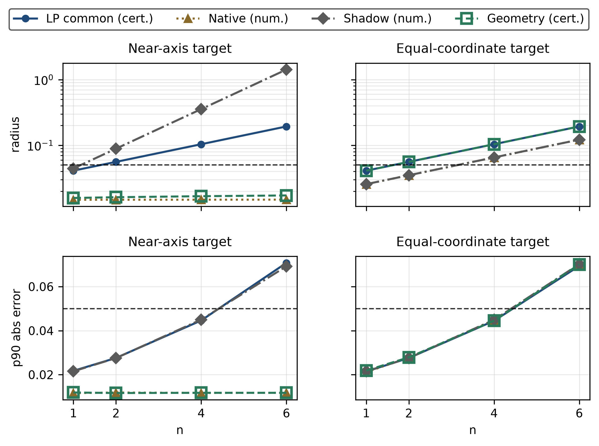

# Product-state fidelity under local Pauli measurements

Research software for estimating fidelity to a known pure product target from full local Pauli measurement outcomes. The repository provides certified estimators, a geometry-based approximation, exact-arithmetic reference implementations, reproducible numerical experiments, and scientific figures.

The unknown state may be an arbitrary i.i.d. mixed state, including correlated or entangled states. Each copy is measured once per qubit in a local X, Y, or Z basis, and the full outcome string is retained.

## Repository layout

| Directory | Contents |
| --- | --- |
| `code/` | Estimators, experiment drivers, and independent verification scripts |
| `data/` | Fixed experimental designs |
| `results/` | Complete recorded results, raw trial means, checks, and a diagnostic report |
| `figures/` | Four research plots and their supporting numerical data |
| `scripts/` | Standalone figure generation and file-integrity verification |
| `docs/` | Reproduction details, assumptions, and interpretation |

## Installation

The numerical implementation was tested with Python 3.13.13, NumPy 2.5.3, and SciPy 1.17.1. Plotting uses Matplotlib 3.11.1. Run commands from the repository root.

```bash
python -m venv .venv
```

Activate the environment:

```powershell
# Windows PowerShell
.venv\Scripts\Activate.ps1
```

```bash
# Linux / macOS
source .venv/bin/activate
```

```bash
python -m pip install -r requirements.txt
# Also install this file if regenerating figures:
python -m pip install -r requirements-plots.txt
```

## Quick start

```bash
# Check that all distributed files match their recorded hashes.
python scripts/check_integrity.py

# Solve a small certified LP instance with a nonsquare copy count.
python code/product_state_estimator.py --k 2 --N 17

# Exercise geometry and exact homogeneous-score examples.
python code/product_state_geometry.py --demo
python code/homogeneous_fidelity.py --demo
```

The estimator modules expose documented Python functions and dataclasses. The geometry wrapper fixes its approximation before data collection and adds an operator-norm bias bound to the sampling radius. The homogeneous complex-score implementation is a bounded exact-rational prototype; the asymptotic theorem is not a claim of practical large-system runtime.

## Verify the recorded results

```bash
python code/verify_finite_size_evaluation.py
python code/verify_extended_evaluation.py
python code/verify_intermediate_geometry.py
```

These scripts independently check recorded experiment structure, moments, raw-data metrics, random seeds, and selected deterministic replays. They write check reports under `results/`. Additional estimator and algebra checks are listed in [the reproduction guide](docs/REPRODUCIBILITY.md).

| Dataset | Rows | Trials per row | Scope |
| --- | ---: | ---: | --- |
| `finite_size_results.json` | 1,360 primary rows | 100 | Eight methods across finite target/input families; also includes resource and feasibility cases |
| `extended_results.json` | 64 | 10,000 | Eight methods, two targets, four sizes, correlated-mixture input, 4,096 copies |
| `intermediate_geometry_results.json` | 16 | 10,000 | Eight methods at two intermediate geometries, six qubits, 4,096 copies |

All prescribed rows, raw trial means, and reported infeasible resource cases are retained. The data are diagnostics at specified inputs, not empirical proofs of worst-case guarantees. Recorded numerical observations are preserved from the original executions; this distribution reorganizes source paths and labels. Original-run hashes and distribution hashes are distinguished in the result metadata.

## Reproduce experiments and figures

Full experiment reruns are more expensive than verification and overwrite the corresponding result files. Use a separate checkout if you wish to preserve the supplied results.

```bash
python code/finite_size_evaluation.py --run
python code/extended_evaluation.py --run
python code/intermediate_geometry_evaluation.py
```

Generate figures in a separate directory to preserve the included images:

```bash
python scripts/plot_finite_size.py --output-dir reproduced_figures
python scripts/plot_extended.py --output-dir reproduced_figures
python scripts/plot_moments.py --output-dir reproduced_figures
```



See [REPRODUCIBILITY.md](docs/REPRODUCIBILITY.md) for the figure/data mapping, full validation commands, and numerical limitations. `manifest.json` pins the distributed files; it is not expected to match files that you deliberately regenerate.

## Interpretation

The LP, inverse-channel, and geometry certificates assume ideal measurement-axis and randomization probabilities. Coefficient and interval rounding are handled explicitly where certified. Hardware calibration errors are outside these guarantees. Native and canonical-shadow comparator bounds use numerical Hoeffding evaluations without rigorous finite-precision certification; the naive proxy has no fidelity confidence interval.

Copy count, local measurement count, solver cost, runtime, and Python allocation measurements are distinct. The simulations use aggregated score distributions, so their runtime is not the runtime of executing every physical measurement callback. No broad practical scaling advantage is claimed.
